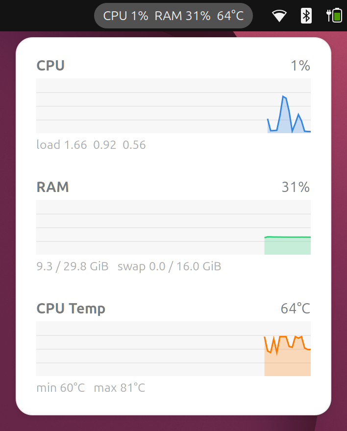

# System Monitor Mini

GNOME Shell extension that shows CPU usage, RAM usage and CPU temperature in the top bar, with history graphs on click or hover.



- Top bar label: `CPU 5%  RAM 32%  66°C`, refreshed every 2 seconds.
- Hover the label (or click it) to open a menu with 3-minute graphs for CPU (with load average), RAM (with used/total GiB and swap) and CPU temperature (with min/max).
- A hover-opened menu closes when the pointer leaves it; clicking while it is open keeps it pinned.
- CPU temperature sensor is detected automatically: `coretemp` Package, `k10temp` Tctl/Tdie, `zenpower`, ThinkPad `CPU`, or a CPU thermal zone.

GNOME Shell 50.

## Install

```bash
git clone https://github.com/piharpi/sysmon ~/.local/share/gnome-shell/extensions/sysmon@harpi
# log out and back in (Wayland), then:
gnome-extensions enable sysmon@harpi
```

## Tested on

| | |
| --- | --- |
| Device | Lenovo ThinkPad E14 Gen 7 (21SX) |
| CPU | Intel Core Ultra 7 255H (16 threads) |
| GPU | Intel Graphics (Arrow Lake-P, integrated) |
| RAM | 29.8 GiB usable |
| OS | Ubuntu 26.04.1 LTS, kernel 7.0.0-38-generic |
| Desktop | GNOME Shell 50.1, Wayland session |
| Temperature sensor | `coretemp` Package id 0 |

## License

GPL-2.0-or-later
